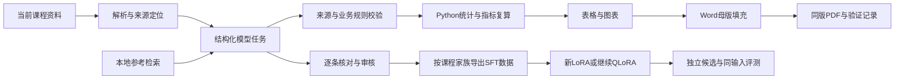

# 课程评价报告生成 Agent · 实验代码包

基于本地 Qwen、结构化输出和确定性计算的课程目标达成分析报告系统。将课程大纲、教学安排、评分规则与成绩表整理为来源可追溯的事实，计算成绩及达成指标，生成表格、图表和同版 Word/PDF；同时提供样本审核、SFT 数据导出、LoRA/QLoRA 训练及候选对照入口。

本包于 **2026-11-13** 从当前工作项目独立整理。原项目不被修改。公开包不包含真实课程资料、学生成绩、正式训练集、参考数据库、基座权重、Adapter、checkpoint 或历史报告。保留小型合成示例和程序重新构建的公开演示母版，便于先在无模型环境验证代码。

这里的“训练”是已有基座上的监督微调：支持**从基座新建 LoRA**和**从已有 Adapter 继续 4-bit QLoRA**，不包含从零预训练大模型。推理默认使用 8-bit；统计、Excel 解析、绘图和排版由程序执行。

## 1. 先选择要运行的路线

| 路线 | 需要准备 | 能验证什么 | 入口 |
|---|---|---|---|
| CPU 测试与离线报告 | Python、文档依赖、LibreOffice、中文字体 | 解析、计算、表图和 Word/PDF 链路；不调用模型 | 第 4 节 |
| 本地模型生成报告 | 完整基座、匹配的 Adapter、GPU 环境及自己的课程资料 | 在线模型任务与报告工作流 | 第 5–7 节 |
| 新建 LoRA 的 smoke | 完整基座、GPU 环境；合成样例由脚本生成 | Tokenizer、loss、梯度、checkpoint 和保存链路 | 第 8 节及 [训练指南](docs/TRAINING.md) |
| 正式 SFT / 继续微调 | 来源核对及审核通过的数据、整课开发留出；继续训练还需起始 Adapter | 自己的数据上的训练与同输入前后对照 | 第 8–9 节及 [训练指南](docs/TRAINING.md) |

原阶段在 7 个真实课程包上完成报告生成与复核，代码测试曾增至 325 项。候选微调没有证明稳定改善成绩识别，因此没有替换现用模型。历史 GPU 实验与公开包本次测试分别记录在 [实验事实与边界](docs/EXPERIMENTS.md) 和 [发布验证结果](validation/RELEASE_VALIDATION.json)，不把合成示例或格式通过率当作模型准确率。

## 2. 工作流与代码结构



模型任务不直接计算统计数值，也不自行生成绘图代码。参考报告用于字段理解和组织方式，不能把其中的学生、成绩、人数或权重冒充当前课程事实。

```text
.
├── run_report.py                 # inspect/run/material-run/refresh/pdf/doctor/catalog
├── train_v2.py                   # review/approve/export/prepare/train/evaluate
├── report_agent/                 # 解析、证据、成绩、评价方案、计算、表图、Word/PDF
├── model_service/                # 本地FastAPI、8-bit加载、Token预算、JSON约束解码
├── training/                     # 审核导出、长度检查、4-bit QLoRA、评测与任务约束
├── scripts/                      # 配置、环境检查、课程登记、参考库、发布检查等
├── configs/                      # 相对路径公开示例；真实本机配置运行时另建
├── examples/demo_course/         # 12名虚构学生的合成课程及明确评分规则
├── templates/course/buu_course_r2/# 重建的公开演示模板、布局、contract和提示词
├── prompts/                      # 当前课程与Agent任务约束
├── tests/                        # CPU回归与发布/训练边界测试
├── docs/                         # 详细操作文档
├── validation/                   # 本代码包构建检查摘要
└── models/ data/ inputs/ outputs/ knowledge/ cases/
                                 # 本地资源位置；Git仅保留说明和空目录占位
```

目录名 `buu_course_r2` 为兼容既有代码路径保留；本包实际模板身份为 `public_course_demo_r1`，不含原学校标志、原报告图像或原母版文件。可运行 `scripts/build_demo_template.py` 从公开 JSON 布局重建它。

## 3. 安装环境

所有命令在**解压后的代码包根目录**执行，不需要使用原项目目录。相对配置路径由代码统一解析到当前项目根。

### 3.1 CPU 文档与测试环境

建议 Python 3.11。在 Ubuntu 中准备系统工具：

```bash
sudo apt-get update
sudo apt-get install -y libreoffice-writer fonts-noto-cjk
python3.11 -m venv .venv-doc
source .venv-doc/bin/activate
python -m pip install -r requirements.txt
```

`requirements.txt` 是默认 CPU 依赖入口，通过 `requirements-test.txt` 引入文档处理、JSON Schema 和约束解码测试依赖，不安装 PyTorch。工作流的 pip 缓存显式跟踪这些拆分文件。可提取文字的文档不需要 OCR；扫描资料再安装 `tesseract-ocr tesseract-ocr-chi-sim` 并在 case 启用 `ocr`。

### 3.2 GPU 推理与训练环境

可复用自己已经验证的兼容环境，也可新建 `.venv-ml`。先安装适配显卡驱动/CUDA 的 PyTorch，再安装：

```bash
# 此处python应指GPU环境，而不是上一节的纯文档环境。
python -m pip install -r requirements-ml.txt -r requirements-structured.txt -r requirements-docagent.txt
```

依赖清单不是跨平台 GPU 版本锁。原阶段实际使用的 Transformers、PEFT、PyTorch 等版本及显存条件见 [环境说明](docs/ENVIRONMENT.md)。原基座约 27B 级；不能将原约 48 GiB 可见显存环境的配置直接视为普通 24 GiB 显卡可运行。训练与推理共用一张卡时，应先关闭本实验的推理服务以释放显存。

## 4. 无模型快速验证：离线报告

在文档环境执行：

```bash
python scripts/build_demo_template.py
python scripts/check_environment.py --runtime configs/runtime.example.json
python -m unittest discover -s tests -q
python run_report.py run \
  --case examples/demo_course/case.json \
  --runtime configs/runtime.example.json \
  --out outputs/offline_demo_r1 \
  --offline
```

正常结果：

- `outputs/offline_demo_r1/report.docx` 与 `report.pdf` 实际存在。
- `calculations.json`、`table_manifest.json`、`chart_manifest.json`、`validation.json` 和 `run_manifest.json` 保存同轮数据与检查。
- 合成案例包含 11 类必选表型和 17 张图；`model_used=false`、`offline_synthetic_only=true`。
- 本次代码包构建验证得到零缺项；自己的环境仍应检查 PDF 的中文、公式、表格和分页。

输出目录必须不存在或为空。再次独立运行改用 `outputs/offline_demo_r2`；不要覆盖旧结果。`--offline` 只接受显式合成案例，不能用于真实课程。

`build_demo_template.py` 会更新母版与 contract 中的资源 SHA。模板改变后应使用新的报告目录；不能继续复用旧模板身份下的结果。

## 5. 准备基座和 Adapter

权重不在代码包内，也没有自动下载步骤。按模型发行方说明自行取得兼容的完整本地快照：

```text
models/base_model/
  config.json
  tokenizer_config.json
  tokenizer.json 或相应vocab/merges文件
  model.safetensors 或索引及全部分片
  该架构所需的其他配置/处理器文件
models/report_adapter/
  adapter_config.json
  adapter_model.safetensors 或完整分片
  训练保存的tokenizer文件（如有）
```

`base_model` 是本地目录名，不是公开下载 ID。代码根据模型配置中的架构选择加载类，使用 `local_files_only=True`。不要只下载 config、把不兼容的预量化权重塞入目录，或改写架构名绕过检查。具体支持范围见 [本地推理指南](docs/LOCAL_INFERENCE.md)。

没有 Adapter 时，先按 [训练指南](docs/TRAINING.md) 从基座新建 LoRA；若仅用合成 smoke 得到 Adapter，其作用仅为接线演示，不能据此宣称课程内容可靠。

显式登记要用的基座和 Adapter：

```bash
python scripts/configure_models.py \
  --base models/base_model \
  --adapter models/report_adapter \
  --bits 8 \
  --base-url http://127.0.0.1:18000
```

它会检查必要文件、计算 Adapter SHA256，并生成当前机器的 `configs/runtime.json`、`configs/model_identity.json`、`configs/training_continue.json`。这些含本机路径的配置默认不提交 Git。脚本拒绝覆盖旧配置；候选可用 `--out configs/runtime.candidate.local.json --runtime-only` 另存，不需要删掉基线。

## 6. 启动本地服务

终端 A，激活 GPU 环境：

```bash
python scripts/check_environment.py \
  --runtime configs/runtime.json --ml --check-cuda --check-model-files
CUDA_VISIBLE_DEVICES=0 python scripts/start_service.py \
  --runtime configs/runtime.json --device-map single \
  --max-input-tokens 8192 --max-output-tokens 2048
```

本实验示例使用 `127.0.0.1:18000`，避免和其他本机项目混用端口。客户端会核对模型路径、Adapter 路径、量化位数和已绑定的 Adapter 哈希。

终端 B，激活文档环境：

```bash
python run_report.py doctor --runtime configs/runtime.json --check-service
```

服务提供 `/health`、`/progress`、`/count_tokens`、`/generate`。完整请求示例、Tokenizer 自检与常见加载问题见 [本地推理指南](docs/LOCAL_INFERENCE.md)。API 是本地实验接口，不包含鉴权或面向公网的服务部署方案。

## 7. 接入自己的课程资料与参考库

### 7.1 登记与检查

将同一课程、同一轮次资料放到 `inputs/current/course_001/`，至少包含可定位学生及实际总评的关键成绩单。考勤表、评分标准和班级汇总不能替代正式成绩。

```bash
python scripts/make_case.py \
  --input-dir inputs/current/course_001 \
  --case-id course_001 --group-id your-course-family-id \
  --course-name "你的完整课程名称" \
  --out cases/course_001.json
python run_report.py inspect \
  --case cases/course_001.json --out outputs/course_001_inspection.json
```

生成器初始将全部材料标为 `current`。随后核对 case 中的来源用途、学年学期、成绩映射及评价制度；历史材料和参考报告要分别标为 `history`、`style_reference`。列号和表头行号从 1 开始，CSV 的 sheet 名为文件名去后缀。完整字段见 [数据格式](docs/DATA_FORMATS.md)。

多表头、同名成绩列、缓考/缺考、学号前导零和课程身份冲突不能通过默认选一列解决。可使用诊断入口：

```bash
python scripts/diagnose_grades.py --help
python run_report.py catalog --root inputs/current --out outputs/material_catalog_r1
```

缺关键成绩时流程会在模型调用前停止，并记录原因。资料自动适配的适用范围有限；自动准备被阻断时，应依据具体原因补充列映射、来源或评价方案，不强行忽略门禁。

### 7.2 在线生成

```bash
python run_report.py run \
  --case cases/course_001.json --runtime configs/runtime.json \
  --out outputs/course_001_r1
```

没有 `facts_path` 时执行在线事实抽取；显式提供核对后的事实文件可以跳过抽取，但写作任务仍可能调用模型。缺少目标细评分或正式映射时，不会凭总分自动证明各项能力。

支持的课程包可使用自动准备入口：

```bash
python run_report.py material-run \
  --case cases/course_001.json --runtime configs/runtime.json \
  --out outputs/course_001_material_r1
```

`material-run` 不是任何课程资料的通用适配器。来源设计、候选评价与总评分离等扩展位于 `report_agent/`；使用候选方案时必须显式传入配置和 `--allow-estimates`，相关状态不能当作正式教学评价认定。

先查看 `validation.json` 和原始来源，再审阅 Word/PDF。`draft_ready` 表示生成链路结束，不等同于人工认可全部内容。图表数随课程目标、考核方式和观测点变化；同类目标矩阵保持单表，长文字换行，长名单跨页重复表头，不拆开单行。

### 7.3 可选参考检索

将有权使用的历史 Word/PDF 放入 `inputs/references/`：

```bash
python scripts/reference_library.py build \
  --source inputs/references --db knowledge/references.sqlite3 --no-ocr
python scripts/reference_library.py query \
  --db knowledge/references.sqlite3 --query "课程目标 考核方式 权重" --top-k 3
```

扫描件去掉 `--no-ocr` 并准备 OCR。把 `configs/reference_library.example.json` 的 `reference_library` 对象加入自己的 runtime，才会在在线流程中启用检索。程序保留 SQLite FTS5 索引与来源哈希；原项目内部数据库不随包提供。

## 8. 训练与微调

完整可执行步骤见 **[docs/TRAINING.md](docs/TRAINING.md)**。建议顺序：

1. 准备兼容基座，在合成数据上验证 Tokenizer 和 5 步 smoke。
2. 使用自己的真实课程运行记录，逐条核对答案及来源，审核后导出。
3. 按课程家族隔离训练与开发验证，禁止同课章节或共享答案跨集合。
4. 先保存基线在固定验证集上的生成结果。
5. 新建 LoRA 或继续 QLoRA，先 `--prepare-only`，再 smoke，最后正式训练。
6. 候选 Adapter 单独保存，重新启动候选服务，对同一验证输入生成前后对照。
7. 结合语义来源与整篇报告检查决定是否采用候选；不自动替换现用模型。

最小的合成数据生成不依赖真实课程：

```bash
python scripts/make_synthetic_sft.py --out data/synthetic_smoke
```

准备好基座和 GPU 环境后，可运行：

```bash
python train_v2.py train \
  --config configs/training_new_lora.example.json --dataset data/synthetic_smoke \
  --out outputs/new_lora_preflight --stage smoke --prepare-only
CUDA_VISIBLE_DEVICES=0 python train_v2.py train \
  --config configs/training_new_lora.example.json --dataset data/synthetic_smoke \
  --out outputs/new_lora_smoke --stage smoke
```

合成数据有明确的机器夹具审核类型，仅允许 smoke，不能改标签后当成正式数据。正式实验所需的真实数据、审核文件、模型及训练结果均需要在本机自行准备。README 不会以假批准或空目录冒充可复现的原训练集。

使用自己的已审核数据继续训练：

```bash
python train_v2.py train \
  --config configs/training_continue.json --dataset data/approved_sft \
  --out outputs/continue_formal --stage formal
```

新建 LoRA 的配置为 `configs/training_new_lora.example.json`；继续微调的配置为初始化后生成的 `configs/training_continue.json`。继续微调时，smoke 和正式训练默认均从所选同一 Adapter 起步；新建 LoRA 时则从同一基座分别初始化。不会自动把 smoke 权重并入正式实验。

checkpoint 恢复使用相同数据/配置及原输出目录，加 `--resume outputs/continue_formal/checkpoint-N`；从一个已完成 Adapter 再做新数据微调，则是新的训练输出和新的配置绑定。二者不同，详见训练指南第 8 节。

## 9. 评测与报告复核

评测前分别启动所需的基线或候选服务，保持相同输入、基座、8-bit 设置、Token 上限及解码规则：

```bash
python train_v2.py evaluate \
  --runtime configs/runtime.json --data data/approved_sft/validation.jsonl \
  --out outputs/baseline_generation.json
python train_v2.py evaluate \
  --runtime configs/runtime.candidate.local.json --data data/approved_sft/validation.jsonl \
  --out outputs/candidate_generation.json
```

这两个命令需要在各自匹配的模型服务启动时分次运行；不能让同一端口当前加载的模型冒充另一个 Adapter。候选配置生成和服务切换的完整命令见训练指南第 7 节。

应分开检查：JSON/schema、任务输入约束、语义与来源正确性、成绩复算、整份报告的图表/漏项/版面。loss 下降、`exact_match` 或结构通过率都不能单独代表报告质量提升。

## 10. 续跑、重排与常见问题

| 情况 | 处理 |
|---|---|
| 报告中断，输入/配置/模板/代码不变 | 原 `run` 命令加 `--resume` |
| 改了成绩、模板或模型配置 | 新输出目录，不能强行续跑 |
| Word 已有但 PDF 失败 | `python run_report.py pdf --run 输出目录 --runtime configs/runtime.json` |
| 只需重排已验证的真实报告 | `python run_report.py refresh --from-run 原任务 --out 新目录`；身份和冻结记录须满足校验 |
| 找不到模板或 SHA 不符 | 先核对是否修改了模板，演示模板可重新生成；正式模板应更新版本与绑定 |
| 中文显示为方块或图表乱码 | 安装中文字体，并在 runtime 配置可用的 `chart_font_path` |
| 模型路径/Adapter 哈希不一致 | 恢复匹配服务或新建独立配置，不能跳过检查 |
| GPU OOM | 释放本实验的服务显存，调整模型规模/长度等条件后做新的 smoke |
| 训练 `--prepare-only` 报数据或 Tokenizer 错误 | 先修数据、真实 tokenizer 或依赖；不是用空模型文件占位 |
| 缺正式目标评分或映射 | 补充本课依据或明确候选设计，不能从参考报告复制事实 |

当前仅启用课程报告路由。毕业设计报告需要另一套模板与评价规则，本包没有启用它。

## 11. 上传 GitHub

仓库根目录已经提供 `.gitignore`：默认排除模型、数据、课程输入、运行产物、内部数据库、本机 runtime、审核记录和常见大文件。公开合成示例与重建演示模板是明确保留的例外。

在这个**独立代码包**根目录执行，替换仓库地址：

```bash
git init
git branch -M main
git add .
git status --short
python scripts/check_release.py --mode tracked
git commit -m "Release course report agent experiment code"
git remote add origin YOUR_GITHUB_REPOSITORY_URL
git push -u origin main
```

`check_release.py` 只检查，不上传、不修改 Git 索引。默认非 Git 解压目录检查全部文件；Git 仓库检查已跟踪文件，避免本机未提交的实验产物干扰。可用 `--mode all` 严格检查整个干净发布目录；使用 `--mode tracked` 前需先 `git add`，新增私有文件不会因为被强制添加而绕过检查。

代码包未替作者指定开源许可证，说明见 [LICENSE_NOTICE.md](LICENSE_NOTICE.md)。上传到自己的 GitHub 仓库时，由维护者选择仓库可见性和适用许可证。本包整理过程没有创建远程仓库或执行 push。

后续在本机增加资料、数据和权重后，若还要导出一份干净的代码 ZIP，可运行：

```bash
python -B scripts/make_release.py --out ../course-report-agent-code.zip
```

打包器按公开代码白名单复制到临时目录，执行发布检查，生成文件级 `MANIFEST.sha256` 和 ZIP 校验文件；不会把 `models/`、`data/`、`outputs/` 等目录中的实际资源带入压缩包，也不会覆盖已有同名 ZIP。它不能替代对代码及文档中新增敏感内容的核对。

## 12. 文档索引

| 文件 | 内容 |
|---|---|
| [docs/ENVIRONMENT.md](docs/ENVIRONMENT.md) | 环境依赖、已运行版本、GPU显存与架构边界 |
| [docs/LOCAL_INFERENCE.md](docs/LOCAL_INFERENCE.md) | 模型准备、配置、服务接口、在线推理 |
| [docs/DATA_FORMATS.md](docs/DATA_FORMATS.md) | case、来源、成绩列映射、评价制度、事实及训练格式 |
| [docs/TRAINING.md](docs/TRAINING.md) | 新LoRA、继续微调、审核导出、对照与checkpoint恢复 |
| [docs/TESTING.md](docs/TESTING.md) | 测试、离线演示与发布检查 |
| [docs/EXPERIMENTS.md](docs/EXPERIMENTS.md) | 原阶段实验事实及复现局限 |
| [RELEASE_NOTES.md](RELEASE_NOTES.md) | 独立整理时改了哪些部分 |
| [validation/RELEASE_VALIDATION.json](validation/RELEASE_VALIDATION.json) | 本代码包本次实际执行的验证摘要 |

模型资源、真实成绩及完整数据集的放置说明分别在 `models/`、`data/`、`inputs/` 等目录下。需要校验原始代码包完整性时，在开始生成本机配置和产物前执行 `sha256sum -c MANIFEST.sha256`。
